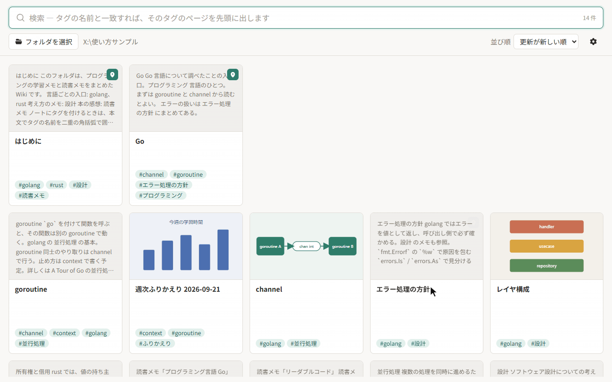

# taggo

Markdown を使った、タグ管理のローカル Wiki デスクトップアプリです（Windows 専用）。
Markdown のフォルダを開くと、タグとリンクでたどれる Wiki になります。ノートはそのまま書き込める、見た目の整ったエディタで編集できます。



## 概要

- **Markdown のノートだけを扱うローカル Wiki**
  - 開いたフォルダの直下にある Markdown を、1 枚ずつのカードとしてフラットに並べて表示します。サブフォルダの中は読みません。
  - 本文で画像や YouTube 動画を使っているノートは、最初の画像または動画のサムネイルをカードに表示します。
  - よく使うノートは、一覧の先頭にピン留めできます。
  - キーワードで検索し、タグとノート同士のリンク、関連ページでたどれます。
- **ファイル名がタグになる**
  - ノートのファイル名（拡張子を除く）が、そのままタグを表します。`golang.md` は `golang` タグのページです。
  - ノートにタグを付けるには、本文に `[[タグ]]` と書きます。Front Matter は使いません。
- **タグはノート自身が持つ**
  - taggo は独自のデータベースを持ちません。ノート自身に書かれたタグを唯一の正の情報として扱います。
  - taggo を使わなくなってもタグはノートと一緒に残り、他のツールからも読めます。

## ノート

- 常に編集できるライブプレビューのエディタ。Markdown のまま書き、見出し・太字・リンク・画像・表・mermaid はその場で整えて見せる（カーソルのある行だけ記号を表示）
- 入力補完：`[[` でタグの候補、`##` で見出し、``` + Enter でコードブロック、`**` で太字の対、Ctrl + I で斜体
- Emacs 風のキー操作：Ctrl + A / E で行頭・行末、Ctrl + P / N / B / F で上・下・左・右、Ctrl + H で 1 文字削除、Ctrl + M で改行、Ctrl + O でカーソルのあるタグ・リンクの行き先を開く
- Ctrl + [ / Ctrl + ] で、見てきた一覧とノートを戻る・進む（Alt + ← / → と同じ）
- 画像を貼り付ける（ドロップする）と、フォルダ直下に保存して本文に埋め込む
- 自動保存（ほかのアプリでの変更とぶつかったら、どちらを残すか選べる）
- 本文の `[[タグ]]` で複数タグ指定可能
- ファイル名がタグを表す（`タグ.md` がそのタグのページ）
- GFM・コードハイライト・mermaid サポート
- `[[タグ]]` と Markdown 同士のリンクをたどる移動（まだ無いページもファイルを作らずに開ける）。外部リンクは下線と「↗」で見分けて、既定のブラウザで開く
- 画面の下端に本文の文字数を表示
- 本文の下に、タグごと（そのタグのページと、そのタグを持つノート）にまとめた関連ページをグリッド表示
- 一覧の先頭へのピン留め（フォルダ直下の `.taggo.json` に保存）
- URL だけを書いた行のリンクカード表示（YouTube・X 対応）
- 本文の埋め込み画像をクリックすると画像ビューアを開く。拡大縮小、全体表示、原寸表示
- ページの名前の変更（そのページを指す `[[タグ]]` とリンクも、すべてのノートで書き換える）

## あえてしないこと

- **本文を勝手に書き換えない。** エディタは Markdown を書いたまま保存し、整形し直したりはしません（文書として編集して Markdown へ書き戻す方式にしないのは、保存のたびにノートに意図しない差分が出るためです）。利用者が書いたもの以外でノートに書き込むのは、ページの名前を変えたときに、そのページを指す `[[タグ]]` とリンクを書き換える場合だけです。新しくファイルを作るのは、まだ無いページで「md ファイルを作成する」を押したとき、検索結果の上の「`タグ.md` を作成する」を押したとき、画像を貼り付けたときだけです。ノート以外に書き込むのは、ピン留めを残すフォルダ直下の `.taggo.json` だけです。
- **フォルダの階層を持たない。** 読むのは開いたフォルダの直下だけです。ファイル名がタグを表すので、同じ名前のノートがフォルダ違いで並ばないようにしています。

## 使い方

[docs/使い方.md](docs/使い方.md) にまとめています。

---

## 機能一覧

### ファイル名がタグ

ノートのファイル名（拡張子を除く）が、そのままタグを表します。`golang.md` は `golang` タグのページで、そのタグが何を表すのかを書いておく場所になります。

- タグの大文字小文字と、空白の連なりは区別しません（`Golang.md` も `golang` タグのページです）。
- `/` や `?` など、Windows のファイル名に使えない文字を含むタグには、ページを作れません。

### ノートにタグを付ける

本文に `[[タグ]]` と書くと、そのノートにタグが付きます。1 つのノートに複数のタグを付けられます。

```markdown
# Go の並行処理

[[golang]] の [[並行処理]] について調べたこと。
```

- 上のノートには `golang` と `並行処理` の 2 つのタグが付きます。
- 本文の `[[タグ]]` は、編集画面ではそのタグのページへのリンクになります。ページがまだ無ければ赤みがかった色で示します。
- コードブロックとインラインコードの中の `[[ ]]` はタグとして読みません。
- タグを付け外しするには、本文の `[[タグ]]` を書き換えます。`[[` と打つと、使われているタグが候補に出ます。
- Front Matter（先頭の `---` で囲んだ YAML）は使いません。`tags:` を書いてもタグにはなりません。ほかのツールで書いたノートの Front Matter は、抜粋と文字数からは外し、編集画面では薄く小さく表示します（書き換えません）。

### 編集

ノートを開くと、そのまま本文を書けます。閲覧と編集の切り替えはありません。

- ファイルには Markdown を書いたまま保存し、見た目だけを整えます。`##` や `**` のような記号は、カーソルのある行（リンクや強調はその要素）でだけ見え、ほかでは隠れます。
- 表と mermaid のコードブロックは、カーソルが外れていると描いた結果になり、クリックすると元の記述に戻ります。`- [ ]` はチェックボックスになり、クリックで切り替わります。
- リンクと `[[タグ]]` はクリックでたどります。記号が見えているときは Ctrl + クリックでたどります。
- 入力補完
  - `[[` と打つと `]]` を補い、タグの候補を出します。
  - 行の頭で `## ` と打つと、その場で見出しになります。
  - 行の頭で {F} と打つと言語名の候補を出し、Enter で閉じの {F} を補います。
  - `**` と打つと閉じの `**` を補います。Ctrl + I で選んだ文字を斜体にします。
- Emacs 風のキーでカーソルを動かせます。Ctrl + A / Ctrl + E で行頭・行末へ、Ctrl + P / Ctrl + N / Ctrl + B / Ctrl + F で上・下・左・右へ動きます（Shift を足すとそこまで選びます）。Ctrl + H は Backspace と同じように消し、Ctrl + M は Enter と同じように改行します。Ctrl + O で、カーソルのある `[[タグ]]` のページや、リンク・URL の行き先を開きます。
- ノートを開いた直後など、本文にカーソルが無いときは、Enter / Ctrl + M / Ctrl + N で本文の先頭から書き始められます。補完の候補が出ている間は、Ctrl + N / Ctrl + P で候補を選びます。
  - 箇条書きや引用の行で Enter を押すと、次の行に同じ記号を補います。
- 画像を貼り付ける（ドロップする）と、開いたフォルダの直下に `20261011-153000.png` のような日時の名前で保存し、本文に `` を入れます。
- 入力が止まって 1 秒で自動保存します。ほかのノートへ移るときやウィンドウを閉じるときも保存します。
- 保存する前に、ほかのアプリでファイルが書き換えられていないかを確かめます。書き換えられていれば保存を止め、「ほかでの変更を読み込む」か「この内容で上書き」かを選べます。書きかけが無ければ、ほかでの変更をそのまま読み込みます。

### 検索

検索バーに入力した文字で、1 文字ごとに絞り込みます。

- 空白で区切った語を、すべて含むノートが結果になります。語はタイトル・ファイル名・本文の抜粋・タグから探します。大文字小文字は区別しません。
- 入力した文字がタグの名前と一致するときは、そのタグのページを結果の先頭に出します。その後ろに、そのタグを付けたノートなどの検索結果が並びます。
- そのタグのページがまだ無いときは、結果の上に「`タグ.md` を作成する」ボタンを出します。押すと、まだ無いページの「md ファイルを作成する」と同じく、見出しだけのファイルを作って編集画面で開きます。ボタンが出ている間は、検索バーで Enter を押しても作れます。ファイル名に使えない文字を含む入力では出しません。
- カードのタグバッジをクリックすると、そのタグで検索します。

### ピン留め

カードの右上か、ノートの画面のヘッダーの「ピン留め」で、ノートを一覧の先頭にピン留めできます。

- ピン留めしたノートは、検索していないときの一覧の先頭に、ピン留めした順で並びます。残りのノートは次の行から並びます。
- ピン留めは、開いたフォルダの直下の `.taggo.json` に保存します。ノートと一緒に同期・バックアップされます。

```json
{
  "pinned": [
    "はじめに.md",
    "golang.md"
  ]
}
```

- 手で書き換えてもかまいません。並べ替えたい場合は、この順番を入れ替えます。taggo の知らない項目は、書き込むときも残します。

### 関連ページ

本文の下に、関連ページをグループに分けてカードのグリッドで並べます。

- **リンク元のグループ**：一番上に、このノートを指しているノートを並べます。このノートが表すタグ（`golang.md` なら `golang`）を持つノートと、Markdown のリンクでこのノートへリンクしているノートです。
- **タグのグループ**：ノートに付いているタグごとに、「そのタグのページ」を先頭に、「そのタグを持つノート」を後ろに並べます。
- **リンク先のグループ**：最後に、このノートが Markdown のリンクでリンクしているノートを並べます。
- どのグループでも、開いているノートと同じタグを多く持つノートほど先に来ます（リンク先のグループは本文でリンクしている順）。
- 前のグループに出したノートは、後のグループには出しません。
- 1 つのグループに並べるのは 24 件までです。それを超える分は「ほか N 件」と出し、タグのグループではクリックでそのタグの検索に移ります。
- グループの見出しの `#タグ` をクリックすると、そのタグで検索します。
- ページの無いタグや、行き先の無いリンクは「まだ無いノート」として点線のカードで出ます。

### まだ無いノート

まだ書いていないノートへのリンクと、ページの無いタグは「まだ無いノート」として関連ページに点線で出て、本文中では赤みがかった色になります。

- クリックすると、ファイルは作らずに、そのページを開きます。本文の代わりに「md ファイルを作成する」ボタンが出て、その下に関連ページ（そのページを指しているノートなど）が並びます。
- 「md ファイルを作成する」を押すと、見出しだけの Markdown ファイルを作ります。作ったファイルはすぐに一覧に載り、開いているページはそのまま編集画面に切り替わって、見出しの下から書き始められます。
- 作る場所は開いたフォルダの直下に限ります。リンクがサブフォルダやフォルダの外を指しているときは開けません。
- タグのページは `タグ.md` という名前で作ります。

### 画像埋め込み

```markdown

```

- 相対パスは Markdown ファイルの位置を基準に、`/` 始まりは開いているフォルダを基準に解決します。
- 表示できるのは、開いているフォルダ配下にある JPEG・PNG・GIF・WebP・AVIF・BMP・SVG です。

### Youtube や X のリンクカード

Markdown の本文に URL だけを 1 行で書くと、カーソルが外れている間、リンク先のタイトル・説明・画像を載せたカードになります。カードは URL の行と置き換わるので、余分な行は取りません。

```markdown
https://www.youtube.com/watch?v=xxxxxxxxxxx
https://x.com/xxxx/status/0000000000000000000
この動画と投稿のメモ。
```

- 空行で区切らなくても、URL だけの行はそれぞれカードになります。
- 上下キーでカードの行に入ると、元の URL に戻って書き直せます。

- 文中のリンクや、`[名前](https://…)` のように表示名を付けたリンクはカードにしません。
- 一般のページは OGP を、YouTube と X（投稿の URL）はそれぞれの oEmbed を読みます。X の投稿は画像を出さず、本文だけを表示します。

### ユーザ設定

設定は `%APPDATA%\taggo\settings.json` に保存します。

- 起動時に開くフォルダ（開かない・前回開いたフォルダ・指定したフォルダ）
- 一覧の既定の並び順（ツールバーで切り替えた並び順は保存しません）
- 1 回の走査の上限件数（デフォルト 20,000 件。1,000〜10 万件。次にフォルダを開いたときと、続きを読み込むときから反映）
- テーマ（OS に合わせる・ライト・ダーク）

### クラウド同期フォルダを開くとき

Dropbox などの同期フォルダも開けます。ノートを taggo の中で編集するため、必要なファイルは手元に持ってきます。

- フォルダを開くと、直下の Markdown をすべて読みます。中身がクラウド上にしか無いノートは、このときダウンロードされます。
- 本文に埋め込んだ画像は、表示するときに読みます。中身がクラウド上にしか無ければ、このときダウンロードされます。
- サブフォルダの中や、本文が参照していないファイルは読みません。読み込みの上限を超えた分も、続きを読み込むまでは読みません。
