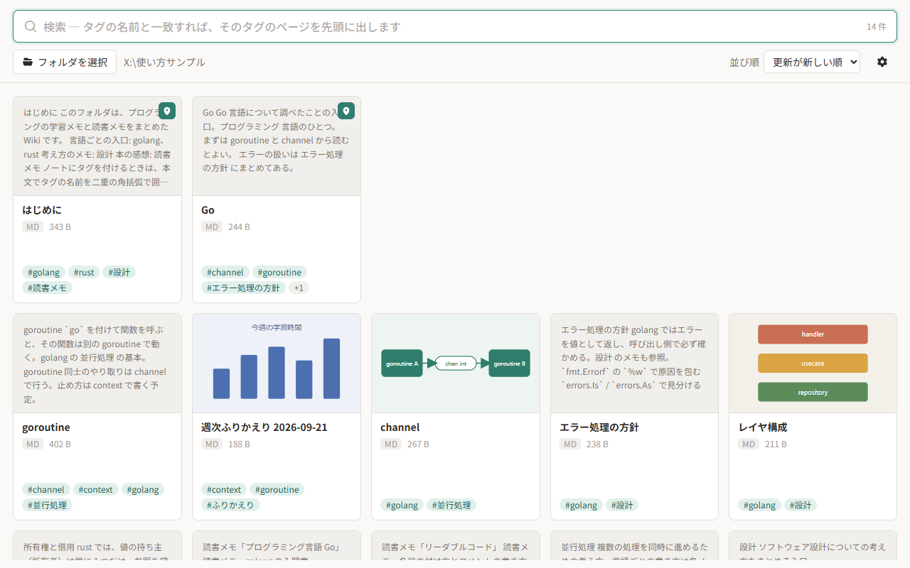
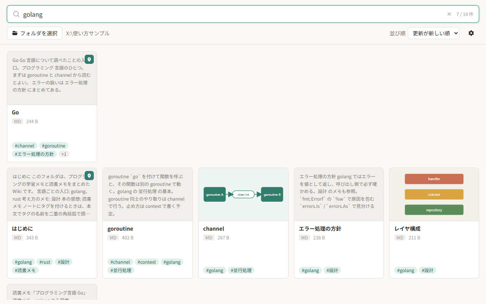
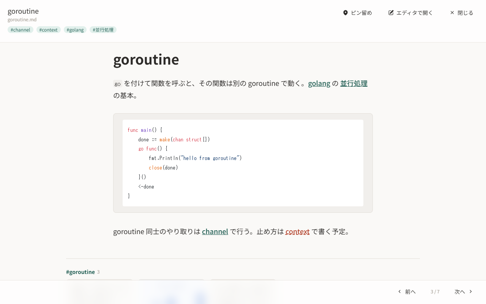
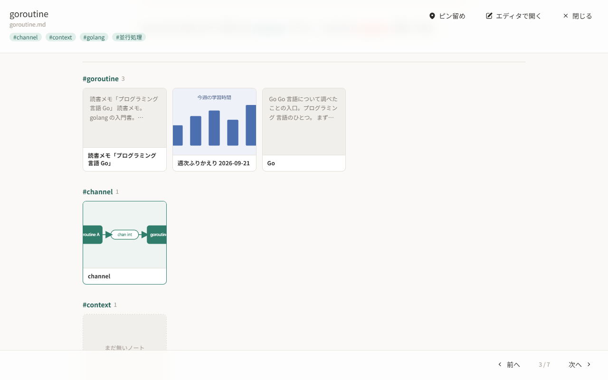
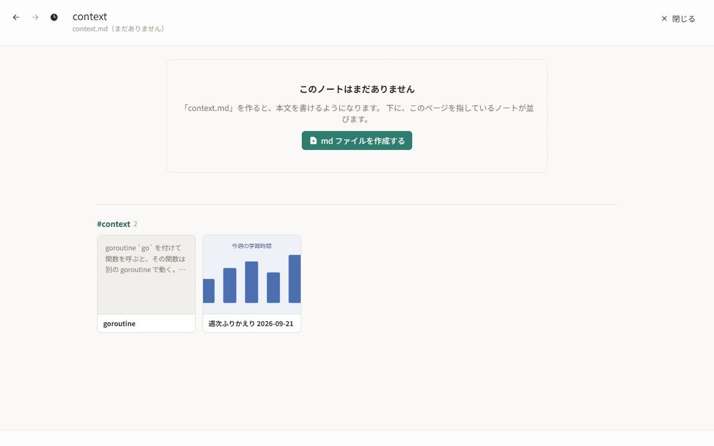
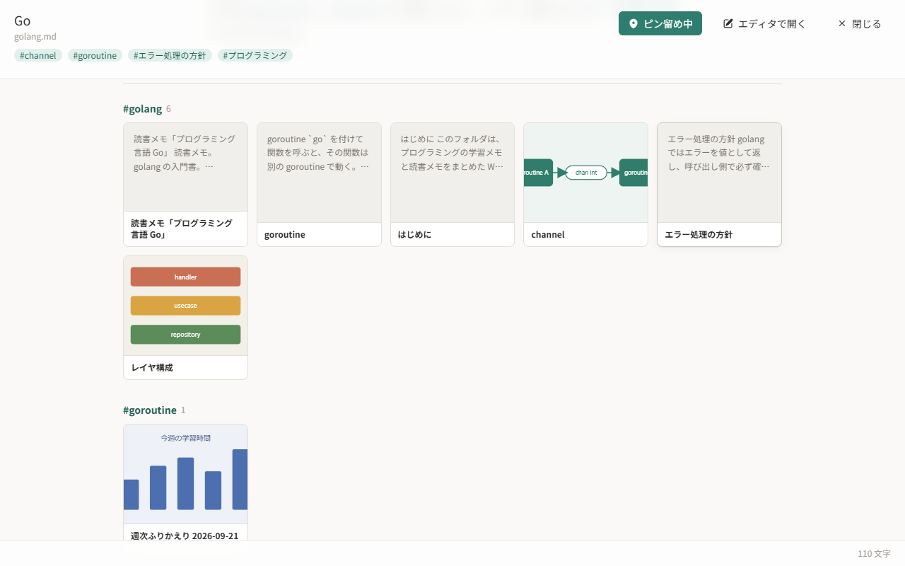
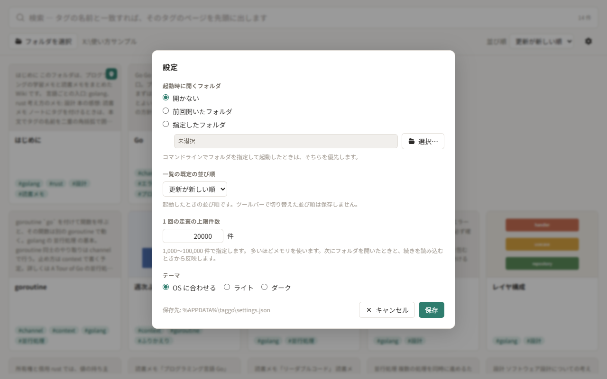

# taggo の使い方

taggo は、フォルダ内の Markdown をカードで並べて、タグとリンクでたどれるようにするアプリです。ノートは taggo の中でそのまま書けます。
ここでは基本的な操作を画面の画像付きで紹介します。細かい仕様は [README](../README.md) を参照してください。

## 1. フォルダを開く

ツールバーの「フォルダを選択」から、Markdown の入ったフォルダを選びます。
フォルダの直下にある Markdown が、1 枚ずつのカードとして並びます。サブフォルダの中は読みません。



- カードには本文の抜粋、タイトル、ノートに付けたタグ（4 行まで）が出ます。タグ欄に収まらない分は「+1」のように数で示し、タグ欄に乗ると全部を表示します。
- 本文に画像や YouTube 動画があるノートは、最初の 1 つをサムネイルとして表示します。
- ピン留めしたノート（後述）は、一覧の先頭の行に並びます。
- 右上の「並び順」で、更新が新しい順・名前順などに切り替えられます。

## 2. 検索する

最上部の検索バーに入力すると、1 文字ごとに絞り込みます。

- 空白で区切った語を、すべて含むノートが残ります。語はタイトル・ファイル名・本文の抜粋・タグから探します。
- 入力した文字がタグの名前と一致するときは、そのタグのページ（後述）が一覧の先頭に出ます。その後ろに、そのタグを付けたノートなどが並びます。
- そのタグのページがまだ無いときは、一覧の上に「`golang.md` を作成する」のようなボタンが出ます。押すと（検索バーで `Enter` を押しても）、フォルダの直下にそのファイルを作って開きます。そのまま本文を書き始められます。
- カードの `#タグ` バッジをクリックすると、そのタグで検索します。
- 検索バーの左の「←」「→」で、これまでに見た一覧とノートを行き来できます（`Alt` + 左右キー、`Ctrl` + `[` / `Ctrl` + `]`、マウスの戻る・進むボタンでも動きます）。タグのクリックで始めた検索は履歴に積まれますが、検索バーへの入力は積まれず、今の一覧の検索語が変わるだけです。



## 3. ノートを開く

カードをクリックすると、ノートが開きます。開いた画面でそのまま本文を書けます（書き方は「4. ノートを書く」）。



- 本文の `[[タグ]]` はリンクになっていて、クリックするとそのタグのページを開きます。ページがまだ無いものは赤みがかった色で出ます。カーソルを置いて記号が見えているときは、`Ctrl` を押しながらクリックします。
- `[[タグ]]` やノートへのリンクは下線なしで、`https://…` などの外部リンクは下線と末尾の「↗」付きで出ます。外部リンクは既定のブラウザで開きます。
- 「名前を変更」で、ページのファイル名を変えられます。詳しくは「ページの名前を変える」を見てください。
- 「削除」で、ページのファイルをごみ箱へ移せます。詳しくは「ページを削除する」を見てください。
- 左上の「←」「→」で、リンクをたどる前後のノートや、開く前の一覧を行き来できます（`Alt` + 左右キー、`Ctrl` + `[` / `Ctrl` + `]`、マウスの戻る・進むボタンでも動きます）。時計のボタンで、これまでに見た画面の一覧から選んで移れます。
- 画面上部や関連ページの `#タグ` をクリックすると、そのタグで検索した一覧に移ります。「←」で元のノートへ戻れます。
- 下端には本文の文字数（改行を除く）が出ます。書くと数え直します。
- 開く前の一覧へは「←」か `Esc` で戻ります。書いた内容は自動で保存されるので、保存の操作は要りません。

本文の下には、関連ページがカードで並びます。



- 一番上がこのノートを指しているノート（リンク元）です。続いてタグごとに「そのタグのページ」と「そのタグを持つノート」がまとまり、最後にこのノートからのリンク先が並びます。
- 前のグループに出たノートは、後のグループには出ません。
- クリックするとそのノートへ移ります。グループの見出しの `#タグ` をクリックすると、そのタグで検索します。
- 本文の末尾で `Ctrl` + `N` を押すと、関連ページの先頭のカードへ移ります。関連ページの中では `Ctrl` + `N` / `Ctrl` + `P` で次・前のカードへ移り、`Enter` で開きます。先頭のカードで `Ctrl` + `P` を押すと、本文の末尾へ戻ります。

まだ書いていないノートへのリンクや、ページの無いタグは「まだ無いノート」として点線で出ます。
クリックすると、ファイルは作らずにそのページを開き、そのページを指しているノートが下に並びます。



「md ファイルを作成する」を押すと、見出しだけのファイルを作り、そのまま本文を書き始められます。

### ページの名前を変える

ノートの画面のヘッダーの「名前を変更」で、ページのファイル名を変えられます。ファイル名はそのままタグなので、そのページを指している参照もあわせて新しい名前に書き換えます。

1. 新しい名前（拡張子なし）を入れて「次へ」を押します。
2. 書き換わるノートの一覧が出るので、確かめて「変更する」を押します。

書き換わるのは次のものです。本文中のふつうの文字列や、コードの中に書いたものは書き換えません。

| 変更前（`page` を `newpage` に変える場合） | 変更後 |
| --- | --- |
| `[[page]]` | `[[newpage]]` |
| `[page](./page.md)` | `[newpage](./newpage.md)` |
| `[詳しく](page.md#節)` | `[詳しく](newpage.md#節)` |
| ページ自身の見出し `# page` | `# newpage` |

- 同じ名前のページが既にあるときは変えられません。大文字小文字だけを変えることはできます。
- ピン留めしていたページは、ピン留めしたまま新しい名前に付け替わります。

### ページを削除する

ノートの画面のヘッダーの「削除」で、そのページのファイルを削除できます。確かめるダイアログで「削除する」を押すと削除し、開く前の画面へ戻ります。

- ファイルは Windows のごみ箱へ移します。間違えて消したときは、ごみ箱から元に戻せます（戻したノートは一覧にも戻ります）。
- ごみ箱の無いドライブ（ネットワークドライブなど）では、Windows が完全に削除してよいかを確かめます。やめると何も消しません。
- ほかのノートに書いた、このページを指す `[[タグ]]` とリンクは書き換えません。まだ無いページを指すようになります。
- 本文に貼り付けた画像は消しません。
- ピン留めしていたページは、ピン留めからも外れます。

## 4. ノートを書く

ノートを開くと、そのまま本文を書けます。中身は Markdown のままですが、見出しは大きく、太字は太く、画像や表はそのまま見える形で表示します。
`##` や `**` のような記号は、カーソルのある行でだけ見えます。

- 行の頭で `## ` と打つと、その行が見出しになります（`#` の数で大きさが変わります）。
- `**` と打つと、閉じの `**` が補われます。そのまま文字を打つと太字になります。文字を選んで `Ctrl` + `I` を押すと斜体になります。
- 行の頭で ``` と打つと、コードの言語名の候補が出ます。`Enter` を押すと閉じの ``` が補われ、間の行でコードを書けます。
- 箇条書き（`- `）や引用（`> `）の行で `Enter` を押すと、次の行にも同じ記号が付きます。
- カーソルは Emacs 風のキーでも動かせます。`Ctrl` + `A` で行頭、`Ctrl` + `E` で行末、`Ctrl` + `P` で上の行、`Ctrl` + `N` で下の行、`Ctrl` + `B` で左、`Ctrl` + `F` で右へ移ります（`Shift` を足すとそこまで選びます）。`Ctrl` + `H` は `Backspace` と同じように 1 文字消し、`Ctrl` + `M` は `Enter` と同じように改行します。`[[タグ]]` やリンク・URL の上で `Ctrl` + `O` を押すと、そのタグのページやリンク先へ移ります。
- ノートを開いた直後など、どこにもフォーカスが無いときは、`Enter`（または `Ctrl` + `M`・`Ctrl` + `N`）で本文の先頭から書き始められます。`Ctrl` + `A` は「すべて選択」には使いません。補完の候補が出ている間は、`Ctrl` + `N` / `Ctrl` + `P` で候補を選べます。
- `- [ ] ` と書くとチェックボックスになり、クリックで付け外しできます。
- 表や mermaid の図、URL だけの行（リンクカード）は、カーソルが外れると描いた形で表示されます。上下キーでその行に入るか、クリックすると元の記述に戻って書き直せます。
- 画像は貼り付ける（`Ctrl` + `V`）か、ドロップすると、フォルダの直下に `20261011-153000.png` のような名前で保存され、本文に埋め込まれます。

書いた内容は、入力が止まって 1 秒ほどで自動的に保存されます。ほかのノートへ移るときや、ウィンドウを閉じるときにも保存されます。
別の PC からの同期など、ほかのアプリで同じノートが書き換えられた場合は、保存を止めて「ほかでの変更を読み込む」か「この内容で上書き」かを選べます。

## 5. タグを付ける

本文に `[[タグ]]` と書くと、そのノートにタグが付きます。

```markdown
# Go の並行処理

[[golang]] の [[並行処理]] について調べたこと。
```

- `[[` と打つと閉じの `]]` が補われ、これまでに使ったタグが候補に出ます。選ぶか、新しいタグをそのまま打ちます。
- 書いたタグは、一覧のカードや画面上部のタグにすぐ反映されます。
- タグを外すときは、本文から `[[タグ]]` を消します。
- Front Matter の `tags:` はタグになりません。

## 6. タグのページを書く

ノートのファイル名が、そのままタグを表します。`golang.md` は `golang` タグのページです。
そのタグが何を表すのか、どこから読み始めるとよいのかなどを書いておく入口に使えます。

```markdown
# Go

Go 言語について調べたことの入口。書き方の方針は [[コーディング規約]] を参照。
```

- `golang` と検索すると、このノートが一覧の先頭に出ます。
- このノートの関連ページでは、`golang` タグを付けたノートが最初のグループに並びます。



- 本文の `[[golang]]` からたどると、まだ `golang.md` が無ければ「まだ無いページ」として開きます。「md ファイルを作成する」を押すと、フォルダの直下に `golang.md` を作って、そのまま書き始められます。

## 7. ピン留めする

よく開くノートは、一覧の先頭にピン留めできます。
カードに乗ったときに右上に出るピンか、ノートの画面のヘッダーの「ピン留め」を押します。

- ピン留めしたノートは、検索していないときの一覧の先頭に、ピン留めした順で並びます。
- ピン留めは、開いたフォルダの直下の `.taggo.json` に保存されます。並べ替えたいときは、このファイルの順番を書き換えます。

## 8. 設定

ツールバー右端の歯車ボタンから開きます。



- 起動時に開くフォルダ（開かない・前回開いたフォルダ・指定したフォルダ）
- 一覧の既定の並び順
- 1 回の走査の上限件数
- テーマ（OS に合わせる・ライト・ダーク）

設定は `%APPDATA%\taggo\settings.json` に保存されます。ノートのタグや内容、ピン留めは保存しません。
